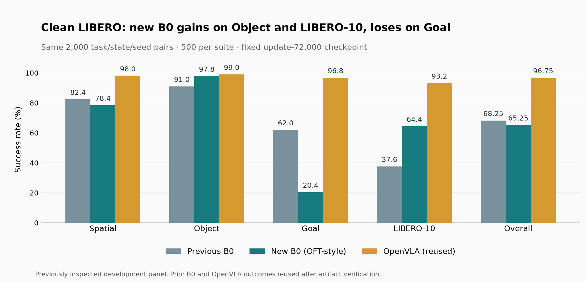

# New B0 clean LIBERO comparison

**Complete:** 2026-09-21 12:00:51 PDT. **Acceptance: FAIL.**
All 2,000 formal new-B0 episodes completed in **3 h 48 min 41 s**, including
the cached evidence audit and final validation. The host-owned service continued
through SSH disconnection, exited 0, and had zero restarts or episode retries.

## Final comparison

| Suite | Previous B0 | New B0 | Reused OpenVLA | New − previous B0 |
| --- | ---: | ---: | ---: | ---: |
| Spatial | 412/500 · 82.4% | 392/500 · 78.4% | 490/500 · 98.0% | −4.0 pp |
| Object | 455/500 · 91.0% | 489/500 · 97.8% | 495/500 · 99.0% | +6.8 pp |
| Goal | 310/500 · 62.0% | 102/500 · 20.4% | 484/500 · 96.8% | −41.6 pp |
| LIBERO-10 | 188/500 · 37.6% | 322/500 · 64.4% | 466/500 · 93.2% | +26.8 pp |
| **Overall** | **1,365/2,000 · 68.25%** | **1,305/2,000 · 65.25%** | **1,935/2,000 · 96.75%** | **−3.00 pp** |

- **New B0 minus OpenVLA:** −31.50 pp, paired 95% interval
  **[−37.65, −25.95] pp**. The upper endpoint is below −5 pp, so the original
  operational acceptance gate remains **FAIL**.
- **New B0 minus previous B0:** −3.00 pp, paired 95% interval
  **[−9.85, +4.25] pp**. This finite panel has 60 fewer successes, while the
  task-cluster interval includes zero. There is no demonstrated overall gain.
- Improvements are uneven: LIBERO-10 adds 134 successes and Object adds 34;
  Goal loses 208 and Spatial loses 20. The Goal regression is the main diagnostic
  priority. These aggregate outcomes do not establish its cause.
- Better supervised validation loss did **not** yield better overall closed-loop
  task success. This result does not support replacing the previous B0 as the
  shared baseline yet. Check paired Goal failure videos and per-suite action/
  language conditioning before choosing another training change.

Intervals use the inherited suite-stratified paired task-cluster bootstrap and
describe variation across task clusters, not uncertainty across training seeds.
Suite intervals in the sealed report are descriptive without simultaneous
coverage. This panel has already been inspected during development.

## Completion evidence

- [Sealed final report](evaluation/week4-oft-clean-comparison-final-v1.json), digest
  `b9cc4c7eda8f7e97a4dcec557e3393c84719843ae49de261c0f9747ed26019af`.
- [Independent final verification](evaluation/week4-oft-clean-comparison-verification-v1.json)
  rechecks all 6,000 sealed receipts and attempt journals, reproduces both paired
  statistics exactly in NumPy 1.26.4, verifies per-task counts and all 4,000
  new-versus-cached paired-input comparisons.
- The runner fully validated all 2,000 new HDF5 recordings. The
  [reuse audit](evaluation/week4-oft-clean-reuse-verification-v1.json) verified the
  bytes of all 4,000 old recordings and their original identities before rollout.
  No OpenVLA or previous-B0 episode was rerun for this comparison.
- New B0 has 695 policy timeouts, zero policy exceptions and zero infrastructure
  failures/retries. One MuJoCo QACC instability warning maps to
  `libero_10/task-09/state-18`, a retained timeout. Its artifact passed targeted
  schema, numeric-array and hash revalidation; it was neither rerun nor excluded.
  The same state also warned in the previous policy runs; no root cause is claimed.
- [Two-episode engineering pilot](evaluation/week4-oft-clean-pilot-v2.json):
  2/2 successes, exact paired inputs, exit 0. The
  [resume audit](evaluation/week4-oft-clean-pilot-resume-v2.json) reused both
  completed episodes while forbidding simulator construction and policy queries.
  The earlier pilot-v1 stopped during the cache audit, before any episode, to fix
  inherited recorder metadata compatibility; its evidence remains on the host.
- Evaluation source: `c1381a1d559d142f354d553a07a7a0fdd3ffff41`, clean and pinned.
  Checkpoint SHA-256:
  `09ec7afad3f7435487334718cd32e310456d3fdea04c65bc888a097ceadaa584`.
- Host output:
  `/home/peimengsui/data/eventground-wam/comparisons/week4-oft-clean-comparison-v1`.
  Recorded output size before the final audit: **77,288,378,717 bytes (~72 GiB)**.
  The job writes recordings, receipts and diagnostics; it creates no model checkpoints.
- Week 4 remains open. The new checkpoint's `dev-210` has not run.

## Evaluation design

The selected OFT-style Qwen3.5-2B checkpoint (update 72,000) runs on the original
40 clean LIBERO tasks × 50 initial states. Compare its 2,000 new outcomes with
the complete verified OpenVLA and previous B0 runs. The checkpoint was selected
by full validation before these new rollouts.

## Frozen scope

The sealed `configs/evaluation/week4_oft_clean_reuse_v1.json` addendum changes
the B0 checkpoint and authorizes reuse of the two completed 2,000-episode policy
runs. Its parent panel describes the original fresh 4,000-episode comparison;
the addendum's explicit reuse override applies to this new comparison.
The original rule, protocol, panel, results and source identities remain intact.
Simulation, task/state/seed order, native policy preprocessing, outcome handling,
five-percentage-point margin, and 20,000-replicate paired task-cluster bootstrap
are inherited unchanged. The episode protocol ID remains the original protocol;
new run identities bind the new comparison addendum and checkpoint.

OpenVLA's fixed baseline is 1,935/2,000 (96.75%); previous B0 is 1,365/2,000
(68.25%). Acceptance uses new B0 minus OpenVLA and the original paired confidence
interval. New B0 minus old B0 has a descriptive paired interval, without another
acceptance gate. All failures remain included. This is a previously inspected
development panel, not an unseen holdout or a training-matched reproduction.

## Evidence and recovery

Before loading the policy, verify the original sealed final report, both policy
identities, all 4,000 receipt digests, and SHA-256 bytes of all saved recordings
and attempt evidence. These hashes bind exactly the HDF5 contents structurally
validated by the original final audit; no old identities or recordings are
rewritten or copied. Every new first policy input must match cached OpenVLA;
the completed settling camera/proprioception/simulator hashes must also match
both original policies. Any mismatch stops execution and withholds acceptance.

The shared durable attempt journals and atomic episode receipts provide resume.
Completed episodes, including policy failures, are reused after verification;
an interrupted episode has at most one recorded retry with identical task,
state and seed. Exhausted infrastructure errors stop acceptance. Final analysis
fully validates every new HDF5 file and writes both paired comparisons, per-task
scores, termination counts and provenance to `comparison-report.json`.

Run `scripts/run_oft_clean_reuse.sh OUTPUT_ROOT` under a persistent, enabled user
systemd service, with user lingering, `flock`, `Restart=on-failure`,
`RestartPreventExitStatus=78`, `RestartSec=60`, and `KillMode=control-group`.
MuJoCo diagnostics are written in the output directory, preserving clean source.
A separate `--pilot-pairs 2` run checks integration before formal execution.
Pilot outcomes never enter the formal comparison. This launch covers clean
LIBERO; the new checkpoint's `dev-210` evaluation remains separate.
