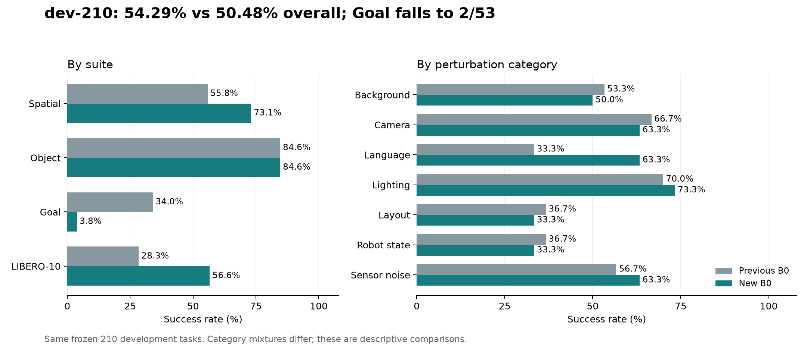
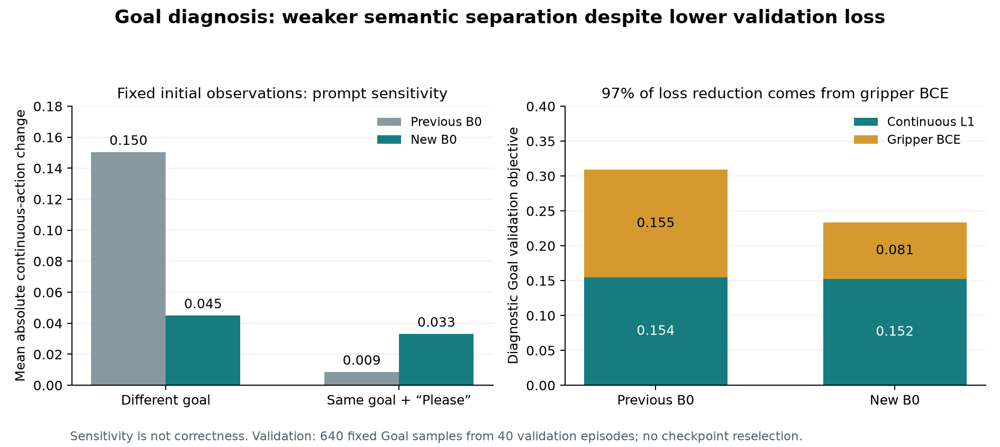

# New B0: Goal investigation and dev-210 evaluation

**Evaluation completed:** September 21, 2026, 13:48:05 PDT.  
**Final audit:** September 21, 2026.  
**Checkpoint:** unchanged OFT-style Qwen3.5-2B B0, update 72,000.

## Executive summary

**dev-210 is complete: 114/210 (54.29%), versus previous B0 106/210 (50.48%).**
The eight additional successes come from Spatial and LIBERO-10 gains that outweigh
a severe Goal regression: **2/53 (3.77%) versus 18/53 (33.96%)**. The evaluation
ran independently on Feifei for **36 min 29 s**, with zero restarts, retries,
policy exceptions or simulator warnings. All 210 recordings passed validation.

**The strongest working diagnosis is weaker instruction-to-goal selection in
the shared Goal scene.** New B0 often performs a plausible manipulation for a
different instruction: turning on the stove instead of moving the bottle,
moving the bowl instead of cream cheese, or using a drawer instead of the
requested destination. Fixed-observation instruction swaps affect its actions
much less than previous B0's, while adding “Please” affects them more.

This is supported by behavior, saved physics states and controlled input probes;
it does not isolate which training or architectural change caused the regression.
Exact recorded-action replay found no discrepancy between diagnostic inference
and the original rollouts. Lower validation loss mostly reflects better gripper
classification on the diagnostic Goal sample, not a large improvement in
continuous control or demonstrated goal selection.

**Keep previous B0 as the shared baseline for now.** The new clean gate remains
FAIL. Test instruction conditioning and training exposure with small controlled
experiments before another full training run. No retraining or checkpoint
reselection was performed during this investigation.

## dev-210 results

| Suite | Previous B0 | New B0 | Change |
| --- | ---: | ---: | ---: |
| Spatial | 29/52 · 55.77% | 38/52 · 73.08% | +17.31 pp |
| Object | 44/52 · 84.62% | 44/52 · 84.62% | 0.00 pp |
| Goal | 18/53 · 33.96% | 2/53 · 3.77% | −30.19 pp |
| LIBERO-10 | 15/53 · 28.30% | 30/53 · 56.60% | +28.30 pp |
| **Overall** | **106/210 · 50.48%** | **114/210 · 54.29%** | **+3.81 pp** |

The descriptive Wilson 95% interval for new B0 is **47.53–60.89%**. Paired
outcomes are 80 successes for both, 34 new-only successes, 26 old-only successes,
and 70 failures for both. The observed increase is not a claim of statistically
established general robustness; this is a small, previously inspected panel
containing related base tasks, with one initial state per perturbed task.

| Perturbation category | Previous B0 | New B0 |
| --- | ---: | ---: |
| Background textures | 16/30 · 53.3% | 15/30 · 50.0% |
| Camera viewpoints | 20/30 · 66.7% | 19/30 · 63.3% |
| Language instructions | 10/30 · 33.3% | 19/30 · 63.3% |
| Light conditions | 21/30 · 70.0% | 22/30 · 73.3% |
| Objects layout | 11/30 · 36.7% | 10/30 · 33.3% |
| Robot initial states | 11/30 · 36.7% | 10/30 · 33.3% |
| Sensor noise | 17/30 · 56.7% | 19/30 · 63.3% |

The Language category includes all four suites. Its nine additional successes
come from Spatial (+6) and LIBERO-10 (+3); **Goal remains 0/7 for both policies
within this category**. The overall language-category gain therefore coexists
with weak Goal instruction selection. Category mixtures differ, so category
scores are not isolated causal measurements of each perturbation.

All 96 new failures are policy-step timeouts. OpenVLA has not been evaluated on
this exact dev-210 panel; its 96.75% clean score is not a dev comparator.

## Goal failures: observations and tests

### 1. Wrong task choices are visible, with matching saved-state evidence

The CPU analysis inspected **all 1,500 clean Goal recordings**: 500 each for new
B0, previous B0 and OpenVLA. It restored every twentieth recorded policy state
plus the final saved state, verified exact physics-state round trips, and
measured task predicates and grasp contacts without running a policy.

For each Goal task, previews use the first state where new B0 fails and both
previous B0 and OpenVLA succeed; if unavailable, the first new failure with an
OpenVLA success. All three policies are exported. The assistant inspected all
ten new-B0 contact sheets and the paired previous-B0 sheets for tasks 0, 3 and 6.
This is illustrative review, not an exhaustive video annotation or prevalence
estimate.

| Requested task | Selected new-B0 behavior | Supporting evidence |
| --- | --- | --- |
| Wine bottle onto cabinet | Turns on the stove, then approaches the bowl | Goal task 0, state 1; old B0 grasps and places the bottle |
| Cream cheese into bowl | Lifts the bowl toward the cabinet, leaving the cheese | Goal task 6, state 1; old B0 moves the cheese into the bowl |
| Bowl onto cabinet | Manipulates a drawer handle; bowl remains on the table | Goal task 3, state 0; old B0 transports the bowl onto the cabinet |
| Bowl onto plate | Moves the bowl onto the stove | Goal task 4, state 0 |
| Turn on stove | Lifts the bowl toward the cabinet | Goal task 2, state 2 |

[Paired video review gallery](../outputs/week4-oft-goal-dev210-analysis/review.html).
The recordings remain the source of record; previews are lossy.

Across all 50 cream-cheese Goal episodes, new B0 has sampled cream-cheese grasp
contacts in **7**, versus **46** for old B0; sampled bowl contacts occur in
**28**, versus **5**. These contacts support the wrong-object observation, but
do not prove intent or stable grasps and can miss brief events between samples.

New B0 has late low motion despite a nontrivial command in **171/398 Goal
failures (43.0%)**. Old B0 has this flag in 93/190 failures (48.9%). Stalling is
common in both and is not a distinctive explanation for the regression. Correct
acquisition and placement can also fail; wrong goal choice is not every failure.

### 2. Changing the intended goal has a weaker effect than before

For both fixed checkpoints, the diagnostic holds camera images and state fixed
and substitutes all ten canonical Goal instructions. It uses state indices
0, 25 and 49 for every Goal task, at first, middle and last policy queries:
**90 observations and 1,980 instruction/paraphrase queries in total**. The
middle/late observations come from new-B0 trajectories and are off-policy inputs
for previous B0. The initial observations are shared by both formal policies.

| Fixed-input probe | Previous B0 | New B0 |
| --- | ---: | ---: |
| Different goal, first observation | 0.1505 | 0.0451 |
| Different goal, middle observation | 0.0771 | 0.0182 |
| Different goal, last observation | 0.0584 | 0.0184 |
| Same goal with “Please”, first observation | 0.0086 | 0.0332 |

Values are mean absolute changes over six continuous action dimensions and
eight predicted actions, in decoded simulator-action units. The new policy's
response to a different goal is **70–76% smaller** across these phases. Its
initial response to the meaning-preserving wording change is about **3.8× larger**.
This supports reduced semantic separation of goals; action sensitivity alone
is not a success metric or proof of causation.

Twenty recorded first/middle queries per checkpoint were also replayed:
**all 40 predicted chunks match their original recordings exactly**. The new
checkpoint, processor dispatch and action decoding reproduce the evaluated
policy on these probes. This check does not rule out every training-side bug.

### 3. Aggregate validation loss hides the relevant weakness

The diagnostic uses the same **2,560 validation examples** for both policies:
four episodes per canonical task, ranked by a fixed hash, with 16 uniformly
spaced anchors per episode. No held-out test observations or actions were read.
The Goal subset has 640 examples from 40 validation episodes. This is a fixed
diagnostic sample, not another full validation or checkpoint selection.

| Goal validation metric | Previous B0 | New B0 |
| --- | ---: | ---: |
| Hybrid objective | 0.30891 | 0.23341 |
| Normalized continuous-action L1/MAE | 0.15439 | 0.15214 |
| Gripper BCE contribution | 0.15452 | 0.08127 |
| Gripper accuracy | 94.96% | 96.66% |

**97.0% of the objective reduction comes from gripper BCE.** Continuous-action
error improves only 1.46%. Expert-trajectory observations often reveal an
already selected object or manipulation phase; good action prediction on those
states can coexist with poor closed-loop instruction-to-goal selection.
That shortcut is a plausible interpretation, not an isolated causal finding.

### 4. Training exposure is substantially lower, without a Goal omission

Exact reconstruction verifies both consumed epoch-plan hashes and all
2,096,581 example presentations. Goal receives **404,679**, versus **1,654,635**
in old B0's five epochs. Each Goal task receives approximately **1.18–1.25
effective epochs**, and Goal's share stays approximately 19.3% in both runs.
There is no evidence of Goal tasks being skipped or disproportionately starved
by the partial second epoch.

The new policy adapts many more parameters under a similar GPU-time budget,
with about one quarter of the previous sample exposure. Insufficient repetition
for learning instruction distinctions is therefore plausible. Architecture,
adaptation coverage and exposure changed together, so this run cannot isolate
their effects.

Continuous action clipping is rare in new Goal rollouts (mean per-episode
saturation fraction **0.024%**). All 500 initial Goal states are inside the new
state-normalization bounds on every dimension. Some later states exceed these
quantiles, so normalization effects still require an ablation to exclude;
initial clipping and pervasive action saturation are weak leading explanations.

## Recommended next experiments

Keep Qwen3.5-2B and continuous L1 plus gripper BCE unchanged.

1. **Run a small controlled continuation comparison.** Compare the current
   episode-blocked batches with task-mixed batches at the same additional sample
   exposure, using the same optimizer, checkpoint and declared compute cap.
   Include the shared-scene Goal instructions in every diagnostic review.
   This tests whether repeated same-task batches and limited exposure encourage
   weak instruction distinctions. Do not change several recipe choices at once.
2. **If semantic separation remains weak, test a direct language-conditioning
   path separately.** A task-text representation supplied directly to the action
   head is a concrete candidate. The old cross-attention decoder retained access
   to all conditioning tokens; the new head consumes action-slot features.
   This architectural difference motivates a test, not a demonstrated cause.
3. **Track goal choice alongside loss.** Report per-task rollouts, wrong-object/
   wrong-destination examples, continuous-action error and gripper BCE separately.
   Keep a fixed development diagnostic panel and checkpoint-selection rule.
   The inspected clean/dev panels remain development evidence.

These are proposed follow-ups. No additional training was launched. Previous B0
remains the stronger clean baseline; the new run's gains on Object and LIBERO-10
are useful evidence to retain rather than an overall acceptance pass.

## Verification and artifacts

- [Sealed dev evaluation](evaluation/week4-b0-oft-dev210-v1.json),
  [selection](evaluation/week4-b0-oft-dev210-selection-v1.json), and
  [completion audit](evaluation/week4-b0-oft-dev210-completion-v1.json).
- [Compact investigation evidence](evaluation/week4-oft-goal-investigation-v1.json),
  [exposure audit](evaluation/week4-oft-training-exposure-v1.json),
  [fixed validation selection](evaluation/week4-oft-validation-diagnostic-selection-v1.json),
  [visual annotations](evaluation/week4-oft-goal-visual-review-v1.json), and
  [preview inventory](evaluation/week4-oft-goal-previews-v1.json), and
  [preview verification](evaluation/week4-oft-goal-preview-verification-v1.json).
- All 30 preview videos decoded to their expected frame counts; all video and
  contact-sheet hashes matched the inventory.
- All 210 first policy input images/states match old B0 exactly. Physics and
  proprioception match throughout the recorded settling prefix. Two Light
  Conditions episodes differ only in earlier settling camera values: 15 channel
  values in one wrist sequence and four in one front sequence, each by one uint8
  intensity unit. No first-query pixel differs. These differences are retained
  in the audit; no episodes were rerun or excluded.
- Runtime/evaluation source remains pinned to
  `c1381a1d559d142f354d553a07a7a0fdd3ffff41`. Both completed evaluation services
  were disabled afterward to avoid restarting completed work on reboot.
- New dev output: **8,557,063,546 bytes (~7.97 GiB)**, under
  `/home/peimengsui/data/eventground-wam/libero-plus/derived/b0/week4-b0-oft-dev210-v1`.
- Full raw Goal diagnostics, scripts and previews remain under
  `/home/peimengsui/data/eventground-wam/analysis/week4-oft-goal-dev210-v1` on Feifei
  and `outputs/week4-oft-goal-dev210-analysis` locally. Compact reports identify
  their sealed digests and script hashes. Checkpoint weights and all original
  rollout outcomes remain unchanged.

**Week 4 remains open because the clean-performance gate is still FAIL.** The
requested new-B0 dev evaluation and Goal investigation are complete.
