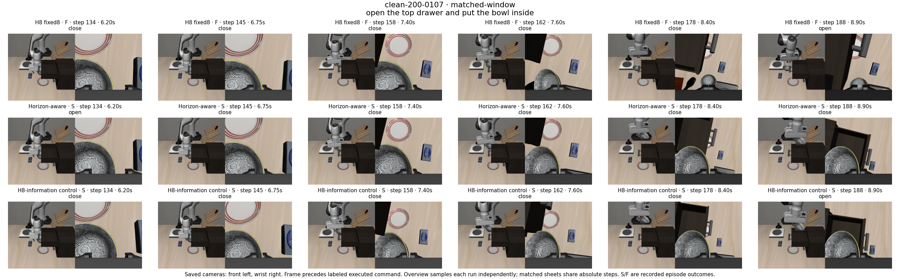
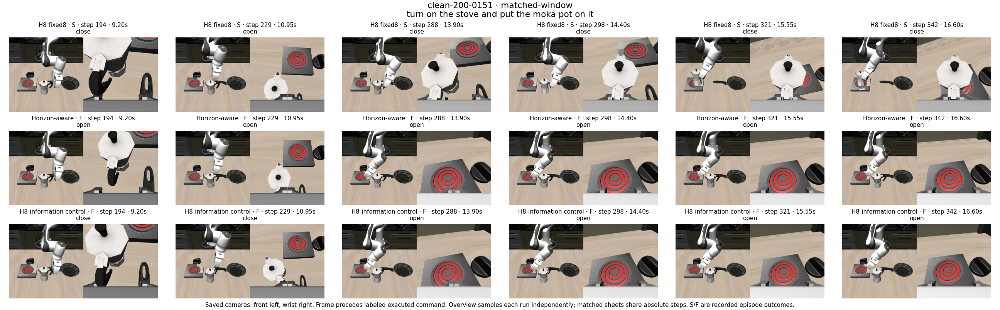
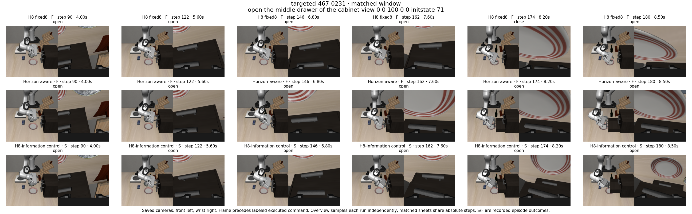

# Qualitative examples and interpretation

Fourteen existing examples balance gains and losses across formal outcome classes and exploratory diagnostics. The formal selection is deterministic within each paired class; the mechanism and forecast examples are selected illustrations, not a frequency estimate. [Open the gallery](gallery.html).

## Formal paired outcomes

| Case ID | Outcome class | Recorded outcomes | Selection |
| --- | --- | --- | --- |
| clean-200-0030 | adaptive_only_success | M4-EG-adaptive: success, M4-EG-fixed8: failure, M4-fixed: failure | first manifest ordinal in each paired outcome class; no quality selection |
| clean-200-0156 | both_failure | M4-EG-adaptive: failure, M4-EG-fixed8: failure, M4-fixed: failure | first manifest ordinal in each paired outcome class; no quality selection |
| clean-200-0000 | both_success | M4-EG-adaptive: success, M4-EG-fixed8: success, M4-fixed: success | first manifest ordinal in each paired outcome class; no quality selection |
| clean-200-0006 | fixed_only_success | M4-EG-adaptive: failure, M4-EG-fixed8: success, M4-fixed: success | first manifest ordinal in each paired outcome class; no quality selection |
| targeted-467-0059 | adaptive_only_success | M4-EG-adaptive: success, M4-EG-fixed8: failure, M4-fixed: failure | first manifest ordinal in each paired outcome class; no quality selection |
| targeted-467-0000 | both_failure | M4-EG-adaptive: failure, M4-EG-fixed8: failure, M4-fixed: failure | first manifest ordinal in each paired outcome class; no quality selection |
| targeted-467-0017 | both_success | M4-EG-adaptive: success, M4-EG-fixed8: success, M4-fixed: success | first manifest ordinal in each paired outcome class; no quality selection |
| targeted-467-0001 | fixed_only_success | M4-EG-adaptive: failure, M4-EG-fixed8: success, M4-fixed: success | first manifest ordinal in each paired outcome class; no quality selection |

The panels preserve both cameras and all three arms. Each arm uses its own first query, midpoint and last recorded pre-action observation; columns are not synchronized time points. Episode success is taken from audited metadata, not inferred from a single image. These snapshots do not alone prove a failure mechanism.

## Mechanism cases

### clean-200-0107

Bowl retention gain: both adapters retain the bowl and succeed, while fixed H8 loses it despite close commands. The H8-information control also reproduces the gain, so this does not isolate non-8 future information. Post-hoc, case-specific inspection; not a representative failure frequency.

### clean-200-0151

Recovery regression: fixed H8 recovers a late pot grasp and succeeds. Neither adapter obtains bilateral pot contact; stove activation alone is insufficient. Post-hoc, case-specific inspection; not a representative failure frequency.

### targeted-467-0231

Wrong-fixture engagement: the motion adapter pulls the bottom drawer while the matched control opens the requested middle drawer. Gripper commands agree through their shared 181-frame span. Post-hoc, case-specific inspection; not a representative failure frequency.

The interpretations above reuse [the saved physical-state inspection](../week11-h8-validation-v1/INSPECTION.md). They concern retention, recovery and fixture engagement in those cases. They do not isolate a universal gripper problem or prove that horizon information alone caused a gain.

## Event forecasting cases

### case-05

contact predicted as grasp. Selected SFT continuation predicts grasp [4, 33]; automatic target is contact [16, 19]. Typed IoU 0.000. Intervals are relative to the anchor; endpoint 33 denotes the clipped window boundary. Future frames are retrospective display only. Automatic predicate agreement is not independent event truth or deployed-policy accuracy.

Task: put both moka pots on the stove. Anchor frame 158. Retained source ID: `c0b7cbc6d20122b140a99ca3ae041ecff01f7f0daa7069f667b200ebbcab7c13`.

### case-09

large onset error with correct event type. Selected SFT continuation predicts grasp [4, 33]; automatic target is grasp [32, 33]. Typed IoU 0.034. Intervals are relative to the anchor; endpoint 33 denotes the clipped window boundary. Future frames are retrospective display only. Automatic predicate agreement is not independent event truth or deployed-policy accuracy.

Task: put the black bowl in the bottom drawer of the cabinet and close it. Anchor frame 93. Retained source ID: `4063241a10229c43336924c11696ff8a10f363f9619268dc0af0b043ae5298c3`.

### case-13

correct event and interval example. Selected SFT continuation predicts contact [32, 33]; automatic target is contact [32, 33]. Typed IoU 1.000. Intervals are relative to the anchor; endpoint 33 denotes the clipped window boundary. Future frames are retrospective display only. Automatic predicate agreement is not independent event truth or deployed-policy accuracy.

Task: pick the bbq sauce and place it in the basket. Anchor frame 22. Retained source ID: `3b5cd345d45226ca1d01aefaeb6d21c93498d2a5a79feb47794e2e4793f340e2`.

## Failure taxonomy boundaries

| Supported observation | Evidence basis | Limit |
| --- | --- | --- |
| Acquisition/retention or recovery loss | Audited physical-state inspections and recorded trajectories | Case-specific; do not infer prevalence from chosen cases |
| Wrong-fixture engagement | Drawer identity in the existing matched adapter inspection | Does not by itself establish that language was ignored |
| Event-type or onset disagreement | Prediction compared with automatic target on retained demonstration windows | Predicate agreement is not independently verified event truth |
| Placement and earlier motion effects | Existing first-chunk and phase/channel interventions | Matched-case causal results only; retain exclusions for pre-intervention drift |
| Hallucinated future / language ignored | No new causal measurement in this package | Do not assign these as proven failure causes |

No four-case fresh H8 investigation, new labeling study or representative failure-frequency analysis is added. The examples preserve the prior scientific boundary.
