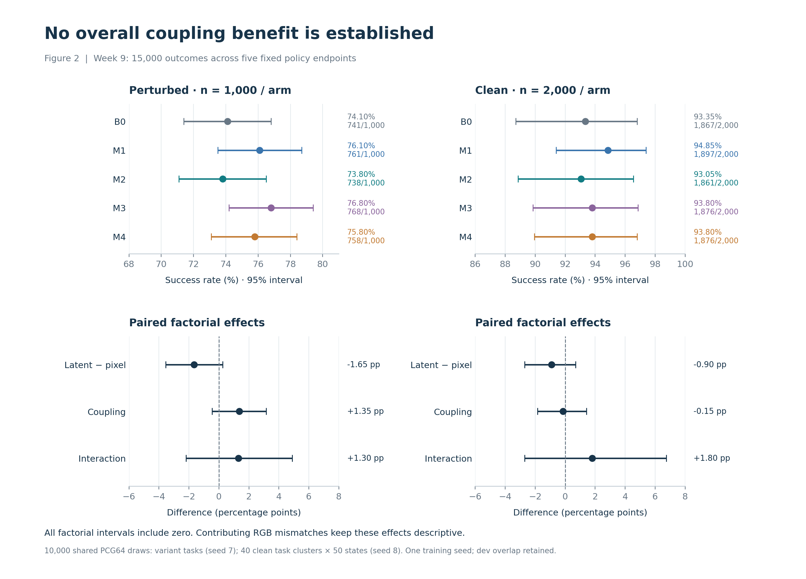
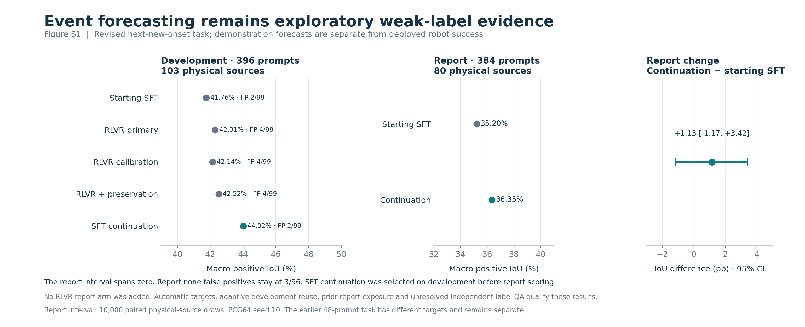
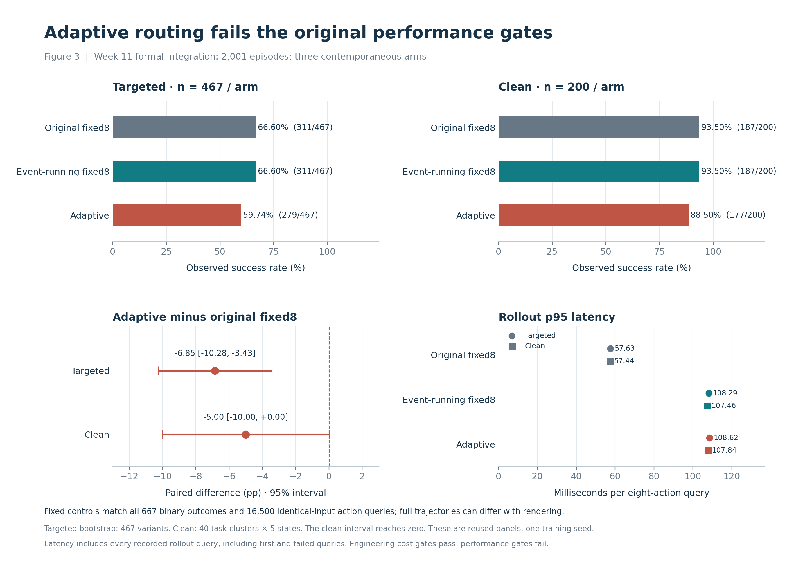
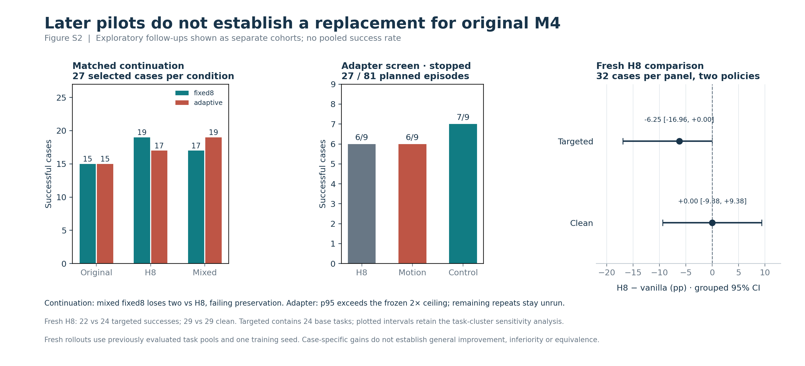

# Consolidated results and statistics

**November 1, 2026: Week 12 Steps 2 and 3 are complete.** This is the numerical and figure handoff for the final report. It consolidates completed experiments under the [frozen reporting scope](../../WEEK12_SCOPE.md). Project-wide reproduction packaging, report drafting and presentation materials remain later steps.

The five-arm study does not establish an overall coupling benefit. The weak-label event study does not establish additional RLVR benefit. Formal adaptive routing fails its performance gates, and later exploratory follow-ups establish no replacement for original M4. M4 remains the Week 11 reference, not a declared overall Week 9 winner.

[Open the figure and example gallery](gallery.html) · [Figure captions and exports](CAPTIONS.md) · [Qualitative evidence](QUALITATIVE.md) · [Full machine-readable results](consolidated.json)

## Study and model map

| Study | Models or conditions | Panel and role | Evidence status |
| --- | --- | --- | --- |
| Week 9 | B0; M1 pixel auxiliary; M2 JEPA auxiliary; M3 pixel coupled; M4 JEPA coupled | 1,000 perturbed cases and 2,000 clean episodes per arm | Frozen planned comparisons; one training seed; affected input comparisons descriptive |
| Week 10 revised task | Starting SFT; primary/calibrated RLVR; preservation hybrid; SFT continuation | 396 development prompts / 103 physical sources; 384 report prompts / 80 sources for SFT and continuation | Exploratory automatic weak labels; repeated development and prior report exposure |
| Week 11 formal | Original M4 fixed8; event-running fixed8; adaptive routing | 467 targeted and 200 clean episodes per arm | Frozen three-arm deployment evaluation; previously evaluated task pools |
| Week 11 continuation | Original, H8 and mixed endpoints × fixed8/adaptive | 27 selected cases per condition; 162 episodes | Exploratory selected-case screen |
| Week 11 adapter | H8 fixed8, motion adapter, H8-information control | First nine-case repeat per condition; 27/81 planned episodes | Partial exploratory screen stopped at latency |
| Week 11 fresh H8 | Vanilla M4 and event-free H8 continuation | 32 targeted and 32 clean cases per condition; 128 episodes | Exploratory fresh episodes in an existing task pool; targeted variants cover 24 base tasks |

The coupled policies add a future-core path and a 1,187,072-parameter coupling block. M1/M2 omit the future branch at deployment. Matched action-training exposure is not matched total compute or tuning effort. Pixel prediction passed its native gates; JEPA retains its original failed front/h2 guardrail and research-use exception. Native pixel and latent losses cannot directly rank prediction quality. [Predictor qualification](../../WEEK6_CLOSEOUT.md).

## Week 9 policy comparison

### Success rates and paired effects

| Arm | Perturbed | Clean |
| --- | --- | --- |
| B0 | 741/1,000 (74.10%; 95% CI 71.40–76.80%) | 1,867/2,000 (93.35%; 95% CI 88.70–96.80%) |
| M1 | 761/1,000 (76.10%; 95% CI 73.50–78.70%) | 1,897/2,000 (94.85%; 95% CI 91.40–97.40%) |
| M2 | 738/1,000 (73.80%; 95% CI 71.10–76.50%) | 1,861/2,000 (93.05%; 95% CI 88.85–96.55%) |
| M3 | 768/1,000 (76.80%; 95% CI 74.20–79.40%) | 1,876/2,000 (93.80%; 95% CI 89.85–96.85%) |
| M4 | 758/1,000 (75.80%; 95% CI 73.10–78.40%) | 1,876/2,000 (93.80%; 95% CI 89.95–96.80%) |

Intervals use 10,000 common PCG64 draws: perturbed variant tasks with seed 7; 40 clean canonical-task clusters, retaining all 50 states, with seed 8. They describe evaluation sampling conditional on one training seed. They are not multiplicity-adjusted confirmatory tests.

| Factorial effect | Perturbed difference, pp [95% CI] | Clean difference, pp [95% CI] |
| --- | --- | --- |
| Latent − pixel | -1.65 [-3.55, +0.25] | -0.90 [-2.70, +0.70] |
| Coupling | +1.35 [-0.45, +3.15] | -0.15 [-1.85, +1.43] |
| Interaction | +1.30 [-2.20, +4.90] | +1.80 [-2.70, +6.75] |

All factorial intervals include zero. Every contributing factorial comparison has RGB mismatches, so these effects remain descriptive. M3−B0 on perturbed cases is the single planned pairwise interval excluding zero (+2.70 pp [0.10, 5.30]); its input mismatches, shared development cases, single seed and multiple comparisons prevent a confirmatory superiority claim. Clean M1−B0 is the only listed pairwise contrast with all initial prefixes exact. No mismatched outcome is removed.

The 1K panel includes all 210 development tasks; the additional 790 form a prespecified secondary slice. Perturbed/clean success ratios compare different task distributions and are not causal perturbation effects. Full contrasts, paired wins/losses, input qualifications and development slices remain in [consolidated.json](consolidated.json); the tabular contrast export is [contrasts.csv](tables/contrasts.csv). [Week 9 authority](../../WEEK9_FINAL_RESULTS.md).

## Week 10 event forecasting

The revised target is the earliest new onset within 32 frames, including anchors where another event is ongoing. Scores measure agreement with automatic predicates. The earlier 48-prompt task had a different target: its RLVR primary pilot passed its engineering gate, and its scores remain separate in the machine-readable history.

| Revised development, 396 prompts / 103 sources | Macro positive IoU | None false positives | Original decision |
| --- | --- | --- | --- |
| Starting SFT | 41.76% | 2/99 | Baseline |
| RLVR primary | 42.31% | 4/99 | No-go |
| RLVR calibration | 42.14% | 4/99 | No-go |
| RLVR + supervised preservation | 42.52% | 4/99 | No-go |
| SFT-only continuation | 44.02% | 2/99 | Passed existing dev gate |

The matched hybrid-minus-SFT-continuation difference is **-1.50 [-3.32, +0.15] pp**. The interval includes zero. Control initialization, prompt order, update count and learning rates were matched; candidate-sampling compute and wall time were not.

The development-selected SFT continuation was evaluated on the fixed report panel without adding an RLVR report arm.

| Report, 384 prompts / 80 sources | Macro positive IoU | None false positives | Matched onset MAE, frames | Positive match coverage |
| --- | --- | --- | --- | --- |
| Starting SFT | 35.20% | 3/96 | 5.396 | 63.19% |
| SFT-only continuation | 36.35% | 3/96 | 5.335 | 63.19% |

Report IoU change is **+1.15 [-1.17, +3.42] pp**, from 10,000 paired physical-source draws with seed 10. All draws are defined. This is a positive point estimate with uncertainty spanning zero. Timing error is conditional on the correctly typed set and must be read with coverage.

Report labels/counts and baseline results had already been inspected. Independent label QA and deployed-policy event accuracy remain unresolved. These scores do not establish improved robot behavior. [Week 10 authority](../../WEEK10_CLOSEOUT.md).

## Week 11 formal adaptive integration

| Arm | Targeted | Clean |
| --- | --- | --- |
| M4-fixed | 311/467 (66.60%) | 187/200 (93.50%) |
| M4-EG-fixed8 | 311/467 (66.60%) | 187/200 (93.50%) |
| M4-EG-adaptive | 279/467 (59.74%) | 177/200 (88.50%) |

| Panel | Contrast | Difference, pp [paired 95% CI] | Left-only / right-only successes |
| --- | --- | --- | --- |
| targeted-467 | M4-EG-adaptive minus M4-EG-fixed8 | -6.85 [-10.28, -3.43] | 19 / 51 |
| targeted-467 | M4-EG-adaptive minus M4-fixed | -6.85 [-10.28, -3.43] | 19 / 51 |
| targeted-467 | M4-EG-fixed8 minus M4-fixed | +0.00 [+0.00, +0.00] | 0 / 0 |
| clean-200 | M4-EG-adaptive minus M4-EG-fixed8 | -5.00 [-10.00, +0.00] | 7 / 17 |
| clean-200 | M4-EG-adaptive minus M4-fixed | -5.00 [-10.00, +0.00] | 7 / 17 |
| clean-200 | M4-EG-fixed8 minus M4-fixed | +0.00 [+0.00, +0.00] | 0 / 0 |

Targeted resamples 467 variants; clean resamples 40 canonical-task clusters retaining all five states. Both use 10,000 common draws (seeds 7 and 8). Targeted has an entirely negative interval; clean reaches zero. Both original performance gates fail. Latency, resources and artifact/input checks passed.

The two fixed controls match all 667 binary outcomes and all 16,500 identical-input action queries. Their full trajectories are not all bitwise equal: small renderer changes precede input/action differences in some pairs. Identical observed control outcomes are not a general equivalence guarantee. Formal panel completion does not create an untouched holdout. [Formal authority](../week11-closeout-v1/RESULTS.md).

## Exploratory follow-ups and stopping decisions

| Matched continuation endpoint | Fixed8 | Adaptive |
| --- | --- | --- |
| Original M4 | 15/27 | 15/27 |
| H8 continuation | 19/27 | 17/27 |
| Mixed continuation | 17/27 | 19/27 |

Mixed adaptive gains two against H8 adaptive, but mixed fixed8 loses two against H8 fixed8 and fails the frozen preservation rule. Mixed adaptive ties H8 fixed8 at 19/27. The selected screen does not qualify a larger evaluation. All 15 paired contrasts are retained as case-level win/loss lists in the consolidated JSON.

| Fresh H8 panel | Vanilla | H8 | Frozen variant result, pp [95% CI] | Task-cluster sensitivity, pp [95% CI] | Base tasks |
| --- | --- | --- | --- | --- | --- |
| targeted-467 | 24/32 | 22/32 | -6.25 [-15.63, +0.00] | -6.25 [-16.96, +0.00] | 24 |
| clean-200 | 29/32 | 29/32 | +0.00 [-9.38, +9.38] | +0.00 [-9.38, +9.38] | 32 |

The targeted 32 variants cover 24 underlying tasks. The supplementary whole-task bootstrap within suites retains all variants and leaves the negative promotion decision unchanged; its equal-base-task point contrast is −8.13 pp (a different weighting from the −6.25 pp variant contrast). Clean contains 32 base tasks. Both the original and supplementary intervals remain exploratory. The small sample does not establish general inferiority or equivalence.

| Workstream | Completed evidence | Disposition |
| --- | --- | --- |
| Closing gate | 81 episodes; fixed8 15/27, original adaptive 16/27, gated 16/27 | Four rescues offset by four regressions; no promotion |
| First-chunk interventions | 12 episodes across three selected failures | Case-specific causal effects with matched controls; no general routing remedy |
| Continuation screen | 162 episodes; two matched 2,000-update endpoints | Fixed8 preservation gate failed |
| Placement, phase and channel interventions | 12 placement-window plus 24 phase/channel episodes | Narrow matched-case motion/state evidence; retain pre-intervention drift exclusions |
| Frozen-H8 adapters | Two matched 2,000-update training arms; exact H8 replay preservation | Endpoints retained as research artifacts |
| Adapter rollout screen | 27/81 episodes: H8 6/9, motion 6/9, control 7/9 | Stopped at p95 latency; 54 remaining episodes closed without execution |
| Fresh event-free H8 comparison | 128 episodes; all 64 pairs audited | Cost target passed, performance criterion failed; no promotion |

Counts above refer to different, often reused cases and must not be added into an independent trial denominator. The optional four-case fresh H8 recording inspection remains deferred; no new review of those cases is included here. [Final Week 11 disposition](../../WEEK11_CLOSEOUT.md).

## Latency and compute cost

The complete [latency table](tables/latency.csv) separates rollout measurements from matched-input timings. Week 9 and formal Week 11 rollout summaries retain every query, including first and failed queries; no warmup or outlier removal is applied. Each query proposes eight actions, so these are not per-action latency or robot-deadline guarantees. Absolute timing differences across separate study executions do not measure a treatment effect.

| Study | Panel | Arm | Queries | Median ms | P95 ms |
| --- | --- | --- | --- | --- | --- |
| Week 9 | perturbed | B0 | 26082 | 43.28 | 44.67 |
| Week 9 | perturbed | M1 | 25701 | 43.58 | 44.98 |
| Week 9 | perturbed | M2 | 26372 | 43.49 | 44.80 |
| Week 9 | perturbed | M3 | 24949 | 46.68 | 48.08 |
| Week 9 | perturbed | M4 | 25576 | 47.37 | 48.82 |
| Week 9 | clean | B0 | 42320 | 42.92 | 44.29 |
| Week 9 | clean | M1 | 41068 | 42.41 | 43.72 |
| Week 9 | clean | M2 | 42739 | 42.58 | 43.91 |
| Week 9 | clean | M3 | 41643 | 45.96 | 47.30 |
| Week 9 | clean | M4 | 42171 | 46.12 | 47.49 |
| Week 11 formal | clean-200 | M4-EG-adaptive | 4523 | 103.03 | 107.84 |
| Week 11 formal | targeted-467 | M4-EG-adaptive | 13452 | 104.49 | 108.62 |
| Week 11 formal | clean-200 | M4-EG-fixed8 | 4223 | 102.42 | 107.46 |
| Week 11 formal | targeted-467 | M4-EG-fixed8 | 12755 | 103.62 | 108.29 |
| Week 11 formal | clean-200 | M4-fixed | 4219 | 52.55 | 57.44 |
| Week 11 formal | targeted-467 | M4-fixed | 12750 | 52.95 | 57.63 |
| Week 11 H8 matched inputs | 108 observations × 3 passes | h8-continuation | 324 | 48.79 | 53.33 |
| Week 11 H8 matched inputs | 108 observations × 3 passes | h8-with-event | 324 | 97.93 | 102.67 |
| Week 11 H8 matched inputs | 108 observations × 3 passes | vanilla-m4 | 324 | 49.67 | 54.40 |
| Week 11 adapter screen | first repeat of 9 cases | h8-fixed8 | 309 | 103.19 | 107.48 |
| Week 11 adapter screen | first repeat of 9 cases | h8-information-control | 300 | 108.54 | 112.65 |
| Week 11 adapter screen | first repeat of 9 cases | horizon-motion | 309 | 109.25 | 112.84 |

The H8 matched-input benchmark uses 108 retained observations, three rotating-order passes and 324 timed queries per condition after warmup. Event-free H8 p95 is 53.33 ms versus vanilla 54.40 ms; the same H8 with its unused event branch costs 102.67 ms. This supports comparable event-free cost, not a general 2% speedup. The adapter screen used a different frozen 2× ceiling and stopped with motion/control p95 ratios 2.026×/2.023×.

| Training component | Hardware | Recorded active hours | Accounting scope |
| --- | --- | --- | --- |
| B0 | RTX 5090 | 45.91 | B0 ledger includes its historical pilot/training/validation budget; M1-M4 use production active-time ledgers. These are not equal-total-compute measurements. |
| M1 | RTX 5090 | 66.47 | B0 ledger includes its historical pilot/training/validation budget; M1-M4 use production active-time ledgers. These are not equal-total-compute measurements. |
| M2 | A10 24 GB | 244.36 | B0 ledger includes its historical pilot/training/validation budget; M1-M4 use production active-time ledgers. These are not equal-total-compute measurements. |
| M3 | RTX 5090 | 66.86 | B0 ledger includes its historical pilot/training/validation budget; M1-M4 use production active-time ledgers. These are not equal-total-compute measurements. |
| M4 | A100 SXM4 40 GB | 177.81 | B0 ledger includes its historical pilot/training/validation budget; M1-M4 use production active-time ledgers. These are not equal-total-compute measurements. |
| shared pixel CPT | RTX 5090 | 14.49 | Count once per module, shared across two policy arms |
| shared latent CPT | RTX 5090 | 20.70 | Count once per module, shared across two policy arms |

Shared pixel and JEPA CPT were each trained once and reused; count each once, not once per downstream arm. Hardware differs across policy runs, so hours cannot be treated as equal-compute comparisons. Full historical tuning time is unavailable and is not zero. The [original cost ledger](../week9-final-v1/cost-ledger.json) retains parameter counts, pilot timing, memory probes and missing-cost qualifications. Later continuation runs each used 2,000 updates and 58,172 presentations; adapter training used the same bounded exposure, not a replacement five-arm training budget.

## Figures and qualitative selection

Figure 1 explains the architecture; Figures 2 and 3 summarize the primary robot studies. Figure 4a–d are the unchanged, previously rendered formal gain/loss panels for targeted and clean cases. Supplementary Figures S1 and S2 cover event forecasting and later pilots. Charts are exported as PNG, SVG and PDF. The figure gallery retains all eight formal outcome classes plus three mechanism cases and three weak-label forecast examples.

Formal examples use the first manifest ordinal in each paired outcome class on each panel. This selection rule is rechecked against the paired matrices. The mechanism and event examples were selected after results and are explicitly diagnostic. Image bytes are copied unchanged and verified against prior media receipts; source IDs, exact recorded steps and captions are in [examples.json](examples.json). No model call, simulator rendering, new rollout or image synthesis is used.

## Verification and remaining limits

Effect estimates and interval endpoints in the prose tables use two-decimal half-up rounding after removing floating-point noise at ten decimals. CSV and JSON retain full precision; rounding does not change any decision.

The [numerical verification record](numerical-verification.json) documents CPU recomputation of all 15,000 Week 9 outcomes, its common-draw rates/contrasts/ratios, all 2,001 formal Week 11 outcomes and paired intervals, revised Week 10 typed IoUs and source-bootstrap comparisons, and the fresh H8 variant and task-cluster sensitivity results. Latency quantiles are checked from retained timing arrays. Continuation pair counts and all 15 win/loss lists are checked against the retained case matrix. Tolerance is 1e-10 absolute and relative.

This verifies retained local metadata and presentation artifacts. Prior recording/input audits remain authoritative; no fresh remote raw-recording or checkpoint rehash is claimed. The Step 1 freeze and consumed source hashes remain intact. The known prior adapter-report prose/hash discrepancy remains recorded in the Week 11 closeout, and no gate is relabeled.

Carry forward one training seed, panel/development reuse, historical transformed-source alias exposure, renderer/input qualifications, JEPA’s failed gate/research-use exception, unresolved independent event-label QA and unresolved on-policy forecasting accuracy. Prediction-quality/task-success correlation is not established by the aggregate tables. Full-10K and test remain locked.
